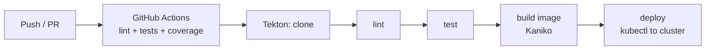

# Customer Accounts Microservice: DevOps Capstone

[](https://github.com/albertmwangwa/devops-capstone-project/actions/workflows/ci.yml)


**A customer accounts REST service built and shipped the DevOps way:** agile planning on a kanban board, test-driven development, security headers, CI on every push, a container image, and a Tekton pipeline that deploys to Kubernetes.

---

## What I built

| Practice | How it shows up here |
| --- | --- |
| Agile planning | User stories from a template (`ISSUE_TEMPLATE/user-story.md`), labelled and estimated, moved across a kanban board over three sprints |
| Test-driven development | 46 pytest tests covering models, routes, error paths, mocks and security behaviour; coverage reported in CI |
| Security | Flask-Talisman security headers and an explicit CORS configuration |
| Continuous integration | GitHub Actions: install, flake8 lint, pytest with coverage against a PostgreSQL service container |
| Containerisation | `Dockerfile` on `python:3.9-slim` |
| Kubernetes | Deployment and Service manifests plus PostgreSQL, run locally on a kind cluster |
| Continuous delivery | Tekton pipeline: clone → lint → test → build (Kaniko) → deploy (kubectl), with OpenShift RBAC |

## The API

Resource: an **Account** with `id`, `name`, `email` (unique), `phone_number`, `address`, `disabled` and `date_joined`.

| Method | Endpoint | Action | Success |
| --- | --- | --- | --- |
| POST | `/accounts` | Create an account | 201, or 400 if the email already exists |
| GET | `/accounts` | List all accounts | 200 |
| GET | `/accounts/<id>` | Read one account | 200, or 404 if missing |
| PUT | `/accounts/<id>` | Update an account | 200, or 404 if missing |
| DELETE | `/accounts/<id>` | Delete an account | 204 |

```bash
curl -X POST localhost:5000/accounts -H "Content-Type: application/json" \
     -d '{"name":"Asha Mrisho","email":"asha@example.com","address":"Dar es Salaam"}'
curl localhost:5000/accounts
```

## Pipeline



## Run it

```bash
git clone https://github.com/albertmwangwa/devops-capstone-project.git
cd devops-capstone-project
python -m venv .venv && source .venv/bin/activate
pip install -r requirements.txt

make test        # run the test suite
make coverage    # HTML coverage report in htmlcov/
make run         # start the service on http://localhost:5000
```

### On Kubernetes (kind)

```bash
kind create cluster --config kind-config.yaml
docker build -t accounts:latest .
kind load docker-image accounts:latest
kubectl apply -f postgres-deployment.yaml -f postgres-service.yaml
kubectl apply -f deploy/
kubectl port-forward svc/accounts 8080:8080   # then use localhost:8080
```

### Tekton

```bash
kubectl apply -f tekton/tasks/ -f tekton/pipeline.yaml -f tekton/workspace.yaml
kubectl create -f tekton/pipelinerun.yaml
```

The secrets and database password in the manifests are lab placeholders. Replace them with real Kubernetes Secrets before deploying anywhere shared.

## Evidence

Screenshots from each sprint are kept in the repo root: kanban boards (`planning-kanban-done.png`, `ci-kanban-done.png`, `security-kanban-done.png`), each REST operation (`rest-*-done`), security headers (`security-headers-done.png`), the running pods (`kube-app-output.jpg.png`) and the CD pipeline (`cd-pipeline-in-progress.png`).

## Context

Built as a DevOps capstone project, then extended with extra error-handling and security tests.

Next improvements: restrict CORS origins (currently `*`), return a `Location` header on create, turn off Flask debug mode outside development, and stop tracking `.coverage`, `__pycache__/` and `instance/accounts.db`.

## Author

**Albert William Mwangwa** · [GitHub](https://github.com/albertmwangwa)
